<!--
  Profile composition, 2026-10-25 redesign.
  Portrait:     python scripts/prep_photo.py && python scripts/make_ascii_svg.py   (local; needs Pillow + OpenCV)
  Info card:    python scripts/make_info_card.py
  Centrepiece:  python scripts/make_ipl_svg.py          (option B, shown)
                python scripts/make_connectome_svg.py   (option A, assets/connectome.svg; to use it, change the
                <h3> to ./connectome.sh and the  src and alt inside the CENTREPIECE markers)
  Daily:        contributions, the upstream ledger and both centrepieces are re-rendered by
                .github/workflows/update-profile-art.yml with the standard library only.
  Brand marks inside the SVGs belong to their projects; see scripts/marks.py.
  Composition inspired by AVIVASHISHTA29/AVIVASHISHTA29; every generator here is original.
-->

<h3><code>mertefe@sysplex ~ $ whoami</code></h3>

<table>
<tr>
<td valign="top"></td>
<td valign="top"></td>
</tr>
</table>

 
 

<h3><code>mertefe@sysplex ~ $ ./ipl.sh</code></h3>

<!-- CENTREPIECE:START (option B: IPL boot map; option A is ./assets/connectome.svg) -->

<!-- CENTREPIECE:END -->

 
 

<h3><code>mertefe@sysplex ~ $ ./contributions.sh</code></h3>

<!-- PROFILE_STATS:START -->

<strong>GITHUB.ACTIVITY / LAST 12 MONTHS</strong> · Total: 4,049 contributions · Current streak: 30 days · Longest streak: 30 days · Best day: 228 contributions on 2026-10-14 · Generated: 2026-10-30

<!-- PROFILE_STATS:END -->

 

<h3><code>mertefe@sysplex ~ $ ./upstream.sh</code></h3>

 
 

<h3><code>mertefe@sysplex ~ $ ./links.sh</code></h3>

<b>Systems Engineer · 2026 IBM Champion · Quantum Research · Open Hardware · Upstream Contributor</b>

  <a href="https://mertefesensoy.dev">PORTFOLIO</a> ·
  <a href="https://github.com/mertefesensoy">GITHUB</a> ·
  <a href="https://www.linkedin.com/in/mert-efe-%C5%9Fensoy-7bbb56290/">LINKEDIN</a> ·
  <a href="https://medium.com/@mefe.sensoy">MEDIUM</a> ·
  <a href="https://orcid.org/0009-0008-3549-0448">ORCID</a> ·
  <a href="https://www.credly.com/badges/b58586a6-8305-47a5-8bd6-6a7e7b1ce69e/public_url">IBM CREDENTIAL</a> ·
  <a href="mailto:sensoymertefe@gmail.com">EMAIL</a>

<code>mertefe@sysplex ~ $ less profile.dossier</code>

 

### `01 / FLAGSHIPS`

Six nodes, one honest line each. Every status names the stage the work has actually reached.

| SYS | Project | What it is | Where it stands |
|:---|:---|:---|:---|
| `FLYB` | [FlyBatch](https://github.com/mertefesensoy/FlyBatch) | The fruit fly's sugar-to-feeding circuit (501 neurons, MaleCNS v1.0) in a portable C89 engine with a COBOL batch driver, giving identical golden fingerprints from x86-64 to MVS 3.8j. | `v0.5.1-rc.1` for testers. Has not run on IBM Z hardware: MVS under Hercules, s390x under QEMU, on one laptop. |
| `SCTD` | [SuperconducTED](https://github.com/SuperconducTED) | Noise as a range, not a number: interval type-2 TSK fuzzy inference turns IBM calibration snapshots into ensembles of Qiskit Aer noise models. | `RESEARCH PREVIEW`. Cycle 1 validated the pipeline; trained membership functions are cycle 2. |
| `CSDR` | [Cassandra Collective](https://github.com/Cassandra-Collective) | Language models for everyday hardware: CASSANDRA (low-hardware LM research), Chorus (sliced mixture-of-experts training), Dervish (a bounded-spectrum Muon-variant optimizer). | Chorus Stage 0 closed as a published negative result (+10.8% bits per character behind centralised at equal compute). Architecture under review. |
| `OMI` | [Open Memory Initiative](https://github.com/The-Open-Memory-Initiative-OMI/omi) | An open, reproducible DDR4 UDIMM reference design: power and PDN, command and clock, data lanes, SPD tooling, and the documentation to learn from it. | `ACTIVE DEVELOPMENT` at schematic stage. Claims never run ahead of validation. [Contribute](https://github.com/The-Open-Memory-Initiative-OMI/omi/issues). |
| `SPDR` | [spdr](https://github.com/The-Open-Memory-Initiative-OMI/spdr) | Read-only DDR5 SPD (JESD400-5) decoder and beyond-CRC semantic linter: `no_std`, allocation-free, `forbid(unsafe_code)`, a library and a CLI. | `v0.1.1` on crates.io. UDIMM complete; SODIMM, RDIMM and LRDIMM wait for real fixtures. |
| `EPHS` | [Ephesus](https://github.com/Cassandra-Collective/Ephesus) | An agent company you govern as its architect: a desktop harness that turns the terminal coding CLIs you already pay for into a self-coordinating crew. | `PRE-ALPHA`, built in public. No releases and no installer; everything runs from source. |

### `02 / SYSTEMS WORK`

- [**Müşahit**](https://github.com/mertefesensoy/MUSAHIT): local-first OSINT briefing pipeline for Turkish news with multi-agent clustering, severity ranking, DuckDB, Ollama and Piper TTS. Operational.
- [**motus**](https://github.com/mertefesensoy/motus): a transport-agnostic messaging seam for C++17 with a per-backend conformance suite and a Windows-safe AMQP-CPP backend. Released, Apache-2.0.
- [**aftershock**](https://github.com/mertefesensoy/aftershock) and [**T-MAC**](https://github.com/mertefesensoy/T-MAC): a message-schema compiler and a simulated urban search-and-rescue command system with deterministic mission verdicts. Fictional scenario, no real hardware.
- [**zbridge-asm-lab**](https://github.com/mertefesensoy/zbridge-asm-lab): Go to z/OS interoperability through assembly, z/Architecture calling conventions, ABI boundaries and endianness. Lab.
- [**crypto-dreamer**](https://github.com/mertefesensoy/crypto-dreamer): a DreamerV3-style BTC/USDT world model with an iTransformer encoder, RSSM core and IQN distributional critic. Research.

### `03 / UPSTREAM`

The ledger above counts public pull requests in repositories I do not own, refreshed daily from GitHub search. Current threads: [zowe/zowe-mcp](https://github.com/zowe/zowe-mcp/pulls?q=author%3Amertefesensoy), [zowe/zowe-explorer-vscode](https://github.com/zowe/zowe-explorer-vscode/pulls?q=author%3Amertefesensoy), [zowe/zowe-cli](https://github.com/zowe/zowe-cli/pulls?q=author%3Amertefesensoy), [microsoft/vcpkg](https://github.com/microsoft/vcpkg/pulls?q=author%3Amertefesensoy), [unitaryfoundation/mitiq](https://github.com/unitaryfoundation/mitiq/pulls?q=author%3Amertefesensoy), [koala73/worldmonitor](https://github.com/koala73/worldmonitor/pulls?q=author%3Amertefesensoy). Maintainers decide merges; the ledger only reports them.

### `04 / ROLE & RECOGNITION`

- **2026 IBM Champion**, recognised for advocacy and technical community work. [View credential](https://www.credly.com/badges/b58586a6-8305-47a5-8bd6-6a7e7b1ce69e/public_url).
- **IBM Z Student Ambassador** and **President of the IBM-Z Club at TED University**: connecting enterprise computing practitioners with the next generation of systems engineers.
- **Computer Engineering at TED University** with a **Business Administration minor**, expected 2027.

### `05 / TOOLCHAIN`

**Systems:** `C89` `C++17` `Rust` `Go` `COBOL` `JCL` `FreeRTOS` `IBM Z`

**Research:** `Python` `Qiskit Aer` `PyTorch` `NumPy / Pandas` `DuckDB`

**Hardware:** `KiCad` `DDR4` `DDR5 SPD` `open tooling`

**Interfaces and platforms:** `TypeScript` `React` `Next.js` `React Native` `Electron` `GitHub Actions` `Docker` `Linux` `Ollama` `Vercel`

### `06 / OPERATING PRINCIPLES`

- **Documentation first.** Architecture decisions are recorded before implementation, in every repository.
- **Honest status.** Every status line names the stage reached and never beyond. Negative results are published with the same care as positive ones.
- **Correctness over speed**, especially in embedded, mainframe and hardware-adjacent systems.
- **Open-source toolchains.** Reproducible environments and inspectable workflows, built in public.

---

Self-contained SVG artwork; no external fonts, scripts or fetches. Public contribution and pull-request data are regenerated daily by GitHub Actions without a personal access token (the workflow's own token only lifts the search rate limit). Motion plays once and respects reduced-motion preferences. Brand marks belong to their projects. Composition inspired by <a href="https://github.com/AVIVASHISHTA29/AVIVASHISHTA29">Avi Vashishta's profile</a>; implementation is original.
